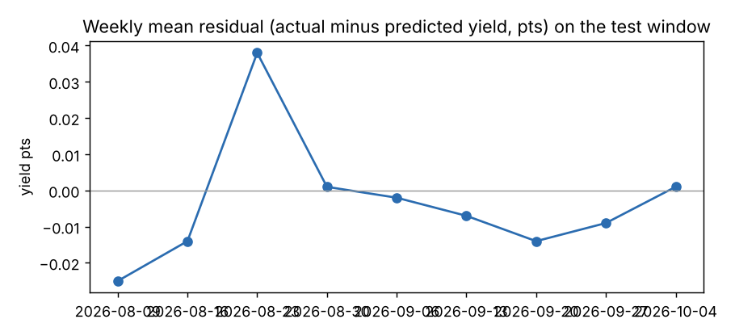
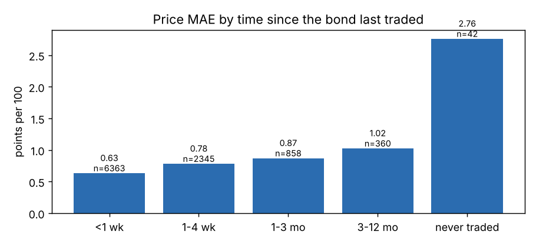
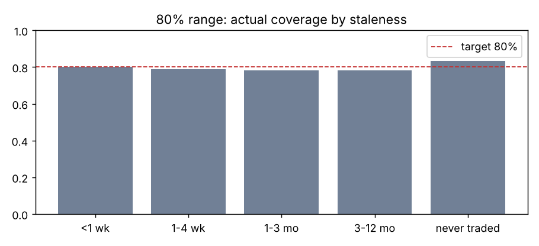
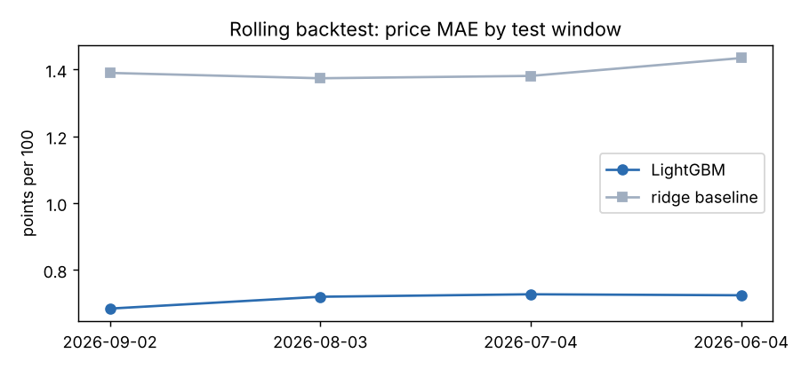
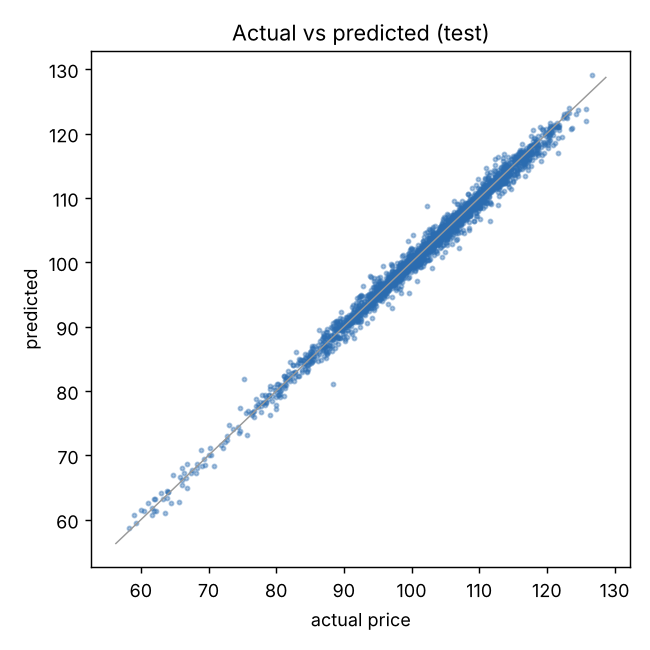

# MuniPricer evaluation

Data: `data/trades_synthetic.csv` (synthetic). Generated by `evaluate.py` on 2026-11-04.

> These numbers describe the pipeline on simulated trades. They say the code works and which design choices matter; they are not a claim about the real market. Retrain on WRDS/MSRB data before quoting accuracy.

## Headline (final split)

- Fit 42,678 trades to 2026-06-18, calibrate on 7,354 to 2026-08-02, test on 9,968 after.
- Price MAE: **0.71** points per 100 (ridge baseline 1.39, 49% lower).
- 80% range: covers **79.5%** of test trades, mean width 2.72 points.
- Conformal margin (yield pts): global 0.027; by staleness <1 wk 0.024, 1-4 wk 0.031, 1-3 mo 0.039, 3-12 mo 0.036, never traded 0.206.

## Rolling backtest

4 test windows of 30 days each, each with its own fit, calibration and test slice.

| fold | test_start | test_end | n_test | baseline_mae | lgb_mae | coverage | width |
|---|---|---|---|---|---|---|---|
| 0 | 2026-09-02 | 2026-10-01 | 4939 | 1.390 | 0.684 | 0.801 | 2.668 |
| 1 | 2026-08-03 | 2026-09-01 | 5029 | 1.374 | 0.720 | 0.792 | 2.723 |
| 2 | 2026-07-04 | 2026-08-02 | 4934 | 1.381 | 0.727 | 0.790 | 2.782 |
| 3 | 2026-06-04 | 2026-07-03 | 4779 | 1.435 | 0.724 | 0.793 | 2.738 |

Across folds: MAE 0.714 ± 0.020, coverage 79.4% ± 0.4%.

MAE by staleness, per fold:

| fold | mae <1 wk | mae 1-4 wk | mae 1-3 mo | mae 3-12 mo | mae never traded |
|---|---|---|---|---|---|
| 0 | 0.601 | 0.760 | 0.879 | 0.961 | 2.385 |
| 1 | 0.646 | 0.790 | 0.847 | 1.018 | 3.285 |
| 2 | 0.650 | 0.768 | 0.932 | 0.892 | 2.832 |
| 3 | 0.649 | 0.764 | 0.880 | 1.120 | 2.217 |

## Ablations

Each row retrains from scratch on the final split with a group of features removed.

| variant | lgb_mae | coverage | width | mae stale (1-3 mo) | mae stale (3-12 mo) |
|---|---|---|---|---|---|
| full model | 0.709 | 0.795 | 2.719 | 0.868 | 1.023 |
| no bond history (last trade, days since, similar bonds) | 0.807 | 0.776 | 3.018 | 0.977 | 1.227 |
| no trade features (size, buy/sell) | 1.147 | 0.786 | 3.823 | 1.180 | 1.355 |
| no market momentum | 0.719 | 0.802 | 2.724 | 0.841 | 1.004 |
| no reference fields (rating, size, call, insured, BQ) | 0.834 | 0.798 | 2.950 | 0.989 | 1.095 |
| v1 target: absolute yield, no benchmark | 0.879 | 0.762 | 3.049 | 1.632 | 1.609 |

Read the gap between a row and the full model as what that feature group is worth.

## Error analysis (final split)

### Residual drift over the test window

Mean (actual minus predicted) yield by week. Values near zero mean the benchmark is carrying the rate level.

| week ending | mean | count |
|---|---|---|
| 2026-08-09 | -0.025 | 1158 |
| 2026-08-16 | -0.014 | 1192 |
| 2026-08-23 | 0.038 | 1164 |
| 2026-08-30 | 0.001 | 1172 |
| 2026-09-06 | -0.002 | 1183 |
| 2026-09-13 | -0.007 | 1161 |
| 2026-09-20 | -0.014 | 1069 |
| 2026-09-27 | -0.009 | 1168 |
| 2026-10-04 | 0.001 | 701 |

### By time since the bond last traded

| b | mae | bias_yield | coverage | width | n |
|---|---|---|---|---|---|
| 1-3 mo | 0.868 | -0.017 | 0.782 | 3.152 | 858 |
| 1-4 wk | 0.780 | -0.001 | 0.788 | 2.990 | 2345 |
| 3-12 mo | 1.023 | -0.044 | 0.781 | 2.992 | 360 |
| <1 wk | 0.631 | -0.000 | 0.800 | 2.504 | 6363 |
| never traded | 2.758 | -0.037 | 0.833 | 8.916 | 42 |

### By years to maturity

| years_to_maturity | mae | bias_yield | coverage | width | n |
|---|---|---|---|---|---|
| 0-3y | 0.166 | 0.003 | 0.756 | 0.583 | 759 |
| 3-7y | 0.407 | -0.004 | 0.792 | 1.534 | 2505 |
| 7-12y | 0.692 | -0.005 | 0.799 | 2.607 | 2941 |
| 12-20y | 0.951 | -0.002 | 0.808 | 3.715 | 2521 |
| 20y+ | 1.200 | -0.007 | 0.792 | 4.658 | 1242 |

### By rating

| rating | mae | bias_yield | coverage | width | n |
|---|---|---|---|---|---|
| A | 0.680 | -0.003 | 0.798 | 2.612 | 801 |
| A+ | 0.655 | -0.010 | 0.803 | 2.476 | 958 |
| A- | 0.730 | -0.010 | 0.795 | 2.747 | 346 |
| AA | 0.767 | -0.005 | 0.787 | 2.925 | 1967 |
| AA+ | 0.727 | 0.000 | 0.801 | 2.700 | 1966 |
| AA- | 0.726 | 0.003 | 0.813 | 2.953 | 1487 |
| AAA | 0.693 | -0.011 | 0.816 | 2.778 | 1305 |
| BBB | 0.754 | 0.013 | 0.713 | 2.469 | 181 |
| BBB+ | 0.710 | -0.001 | 0.742 | 2.542 | 322 |
| BBB- | 0.446 | 0.008 | 0.734 | 1.678 | 229 |
| NR | 0.629 | -0.010 | 0.773 | 2.368 | 406 |

### By trade type (MSRB: D inter-dealer, P dealer buys from customer, S dealer sells to customer)

| trade_type | mae | bias_yield | coverage | width | n |
|---|---|---|---|---|---|
| D | 0.742 | -0.002 | 0.793 | 2.752 | 2484 |
| P | 0.685 | -0.009 | 0.796 | 2.682 | 3472 |
| S | 0.710 | -0.000 | 0.796 | 2.731 | 4012 |

### By trade size

| par_traded | mae | bias_yield | coverage | width | n |
|---|---|---|---|---|---|
| <25k | 0.702 | -0.006 | 0.802 | 2.726 | 5379 |
| 25-100k | 0.710 | -0.000 | 0.797 | 2.732 | 3772 |
| 100k-1M | 0.752 | -0.001 | 0.742 | 2.621 | 814 |
| >1M | 0.923 | -0.108 | 0.667 | 1.326 | 3 |

### By sector

| sector | mae | bias_yield | coverage | width | n |
|---|---|---|---|---|---|
| Electric Utility | 0.777 | -0.001 | 0.798 | 2.966 | 545 |
| General Obligation | 0.658 | -0.002 | 0.807 | 2.645 | 4000 |
| Healthcare | 0.731 | -0.008 | 0.754 | 2.537 | 614 |
| Higher Ed | 0.683 | -0.021 | 0.798 | 2.544 | 799 |
| Housing | 0.760 | 0.006 | 0.817 | 2.978 | 432 |
| School District | 0.789 | -0.004 | 0.793 | 2.905 | 1081 |
| Transportation | 0.687 | 0.002 | 0.783 | 2.668 | 1186 |
| Water & Sewer | 0.781 | -0.006 | 0.783 | 2.840 | 1311 |

### Twenty worst misses

| cusip | trade_date | trade_type | par_traded | rating | years_to_maturity | days_since_last_trade | price | pred | resid_px | width |
|---|---|---|---|---|---|---|---|---|---|---|
| 368162GX2 | 2026-08-18 00:00:00 | S | 70000.00 | AA+ | 15.17 |  | 94.45 | 105.56 | -11.10 | 13.62 |
| 234304LZ5 | 2026-08-07 00:00:00 | D | 20000.00 | AA- | 16.21 |  | 93.16 | 102.97 | -9.81 | 15.11 |
| 269113VC1 | 2026-09-16 00:00:00 | D | 60000.00 | A+ | 20.05 |  | 111.04 | 102.57 | 8.47 | 15.70 |
| 238819VT5 | 2026-09-08 00:00:00 | S | 5000.00 | AA | 9.02 |  | 106.82 | 98.37 | 8.45 | 8.53 |
| 705688UL8 | 2026-08-21 00:00:00 | P | 70000.00 | A+ | 23.97 |  | 81.29 | 89.15 | -7.86 | 16.97 |
| 340307UM6 | 2026-08-31 00:00:00 | S | 45000.00 | AA- | 25.71 |  | 86.93 | 79.45 | 7.48 | 15.31 |
| 282269ZP5 | 2026-09-10 00:00:00 | S | 10000.00 | AA+ | 27.26 | 316.00 | 88.33 | 81.07 | 7.26 | 3.89 |
| 252650XS2 | 2026-09-24 00:00:00 | D | 5000.00 | AA- | 17.62 | 38.00 | 109.05 | 102.36 | 6.69 | 5.68 |
| 206630GW9 | 2026-09-19 00:00:00 | D | 20000.00 | BBB | 24.66 |  | 75.23 | 81.85 | -6.62 | 15.87 |
| 190930WB4 | 2026-08-21 00:00:00 | P | 50000.00 | AAA | 17.88 | 9.00 | 102.24 | 108.75 | -6.51 | 4.52 |
| 183818QA2 | 2026-09-03 00:00:00 | D | 165000.00 | NR | 30.08 | 317.00 | 76.93 | 70.75 | 6.17 | 5.31 |
| 573738JZ2 | 2026-08-18 00:00:00 | P | 20000.00 | AA | 22.09 | 6.00 | 87.03 | 92.98 | -5.95 | 4.53 |
| 512040DX8 | 2026-08-13 00:00:00 | D | 5000.00 | AA+ | 30.13 | 59.00 | 111.57 | 106.40 | 5.17 | 6.90 |
| 872113CT0 | 2026-08-10 00:00:00 | S | 20000.00 | AA | 23.99 | 8.00 | 98.86 | 104.03 | -5.17 | 5.53 |
| 406047FM0 | 2026-09-01 00:00:00 | P | 10000.00 | AA | 30.08 | 160.00 | 104.24 | 99.42 | 4.82 | 5.15 |
| 267189MN9 | 2026-09-01 00:00:00 | S | 100000.00 | AA | 17.91 | 9.00 | 106.98 | 102.16 | 4.82 | 5.83 |
| 717193AF0 | 2026-08-14 00:00:00 | D | 15000.00 | AA+ | 27.12 | 12.00 | 121.94 | 117.17 | 4.78 | 6.66 |
| 263321YT6 | 2026-08-27 00:00:00 | P | 25000.00 | A | 15.07 | 31.00 | 104.91 | 100.14 | 4.77 | 3.92 |
| 969764YY2 | 2026-09-14 00:00:00 | D | 85000.00 | AA+ | 28.25 | 76.00 | 107.18 | 111.92 | -4.74 | 7.42 |
| 355168GS3 | 2026-08-27 00:00:00 | D | 20000.00 | AA+ | 19.92 | 18.00 | 121.64 | 117.01 | 4.63 | 6.09 |

### Feature importance (gain share)

|  | gain |
|---|---|
| this bond's last trade | 0.757 |
| recent trades in similar bonds | 0.100 |
| trade type (buy/sell/dealer) | 0.034 |
| years to maturity | 0.025 |
| issue size | 0.016 |
| state | 0.014 |
| credit rating | 0.013 |
| time since last trade | 0.008 |
| market direction this week | 0.008 |
| trade size | 0.008 |
| sector | 0.007 |
| coupon rate | 0.006 |
| callable | 0.003 |
| bank qualified | 0.001 |
| bond insurance | 0.001 |

## Charts

